# Faster R-CNN (ResNet-50-FPN) sur COCO

TP de détection d'objets — Master MQL, Faculté des Sciences de Tétouan.

Implémentation, entraînement et évaluation d'un détecteur **Faster R-CNN** avec un backbone **ResNet-50 + FPN** pré-entraîné sur ImageNet, sur le dataset **COCO 2017** (80 classes), avec PyTorch / torchvision.

## Contenu

| Fichier | Description |
|---|---|
| `TP_FasterRCNN_ResNet50_COCO_Kaggle.ipynb` | Notebook complet, commenté en français, prêt pour Kaggle (GPU) |
| `requirements.txt` | Dépendances pour une exécution locale |
| `results/metrics.json` | Toutes les métriques de l'exécution Kaggle |
| `results/figures/` | Graphes et exemples de détection obtenus |

## Étapes du notebook

1. Configuration de l'environnement et des hyper-paramètres
2. Préparation des données COCO : localisation du dataset, sous-ensembles reproductibles, exploration (classes, tailles, densité)
3. `Dataset` PyTorch et `DataLoader` (conversion des boîtes, flip horizontal)
4. Architecture Faster R-CNN : ResNet-50 + FPN, RPN, RoI Align, tête de classification / régression
5. Entraînement : SGD, warm-up + décroissance cosinus, précision mixte (AMP), gradient clipping
6. Courbes d'apprentissage (pertes, LR, mAP par époque)
7. Évaluation COCO : mAP@[.5:.95], AP@.5, AP@.75, AP par taille, AR, courbes précision-rappel, AP par classe, analyse des scores
8. Exemples de détection (meilleurs cas, cas difficiles, images d'entraînement)
9. Comparaison avec le modèle de référence torchvision entraîné sur COCO complet
10. Conclusion et pistes d'amélioration

Chaque bloc de code est suivi d'une explication, et chaque graphe d'une **interprétation calculée automatiquement à partir des résultats obtenus**.

## Résultats obtenus

Exécution sur **Kaggle (GPU T4)** : **3 000 images** de COCO train2017 (22 158 objets, 80 classes), **5 époques**, évaluation sur **500 images de val2017** jamais vues (3 705 objets). Entraînement : **25,7 min** (notebook complet : 30 min).

### Métriques COCO (validation)

| Métrique | Notre modèle (train) | **Notre modèle (validation)** | Référence torchvision (COCO complet) |
|---|---|---|---|
| mAP @[.5:.95] | 0.138 | **0.084** | 0.375 |
| AP @.5 | 0.290 | **0.189** | 0.576 |
| AP @.75 | 0.114 | **0.060** | 0.406 |
| AP small / medium / large | 0.087 / 0.206 / 0.158 | **0.047 / 0.106 / 0.146** | 0.234 / 0.402 / 0.539 |
| AR @100 | 0.304 | **0.230** | 0.533 |

Vitesse d'inférence : **12,5 images/s** (80 ms/image) sur GPU T4. Toutes les valeurs sont dans [`results/metrics.json`](results/metrics.json).

### Évolution pendant l'entraînement

| Époque | Perte | val mAP | val AP@.5 | val AR@100 |
|---|---|---|---|---|
| 1 | 1.273 | 0.003 | 0.009 | 0.021 |
| 2 | 1.164 | 0.014 | 0.037 | 0.070 |
| 3 | 1.080 | 0.038 | 0.097 | 0.131 |
| 4 | 0.966 | 0.072 | 0.171 | 0.208 |
| 5 | 0.883 | **0.084** | **0.189** | **0.230** |

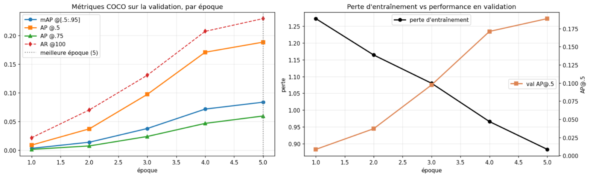

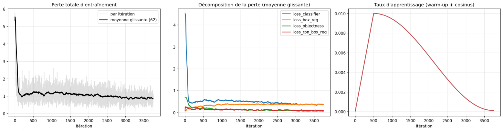

### Exemples de détection (images de validation)

Gauche : vérité terrain (vert) — droite : prédictions du modèle (orange, score ≥ 0.5).

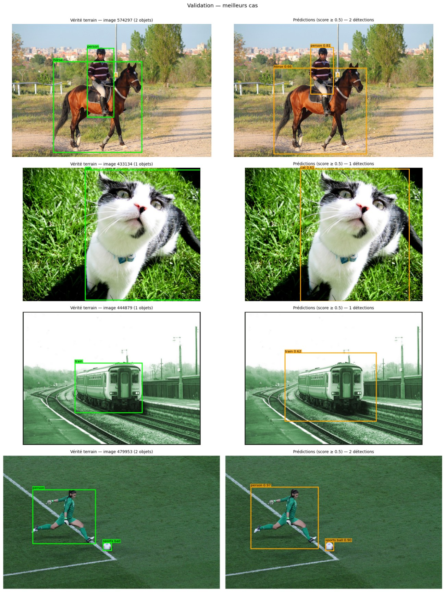

Cas difficiles (seuil abaissé à 0.3) :

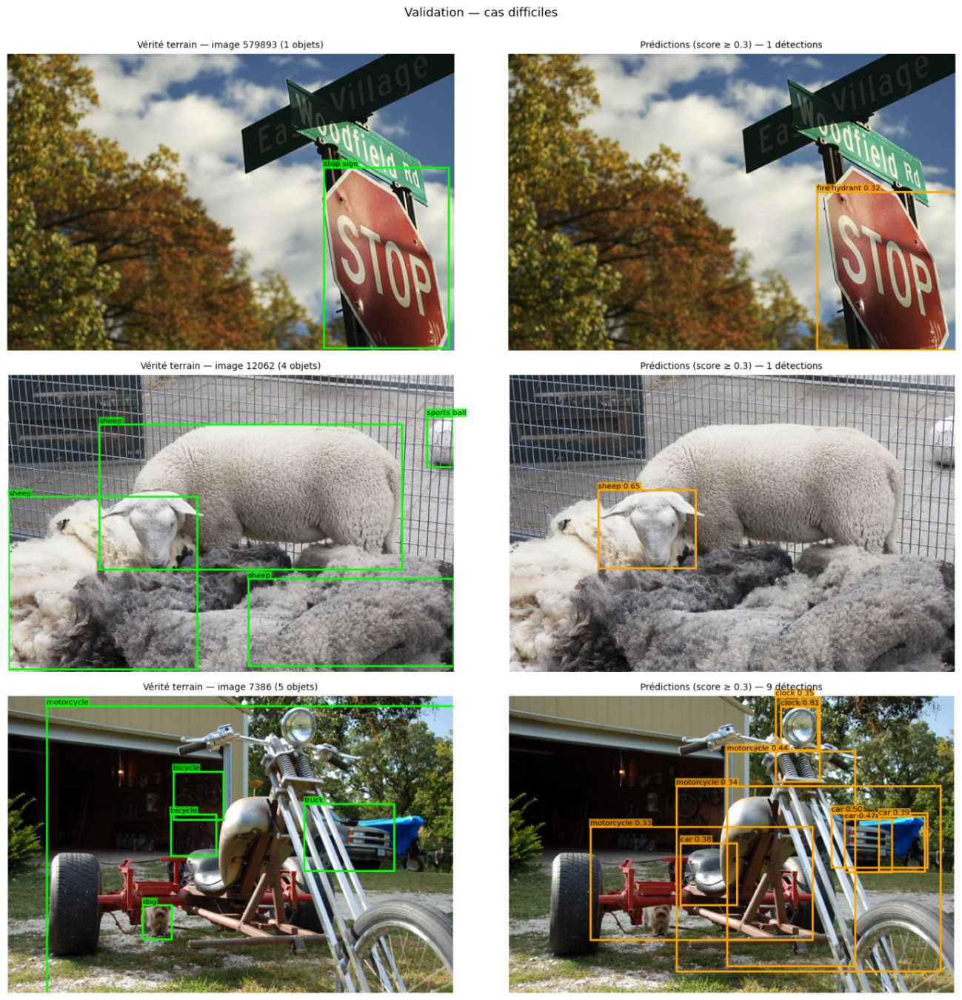

### Analyse

- **Le modèle apprend réellement** : la perte baisse de 31 % (1.27 → 0.88) et la mAP de validation est multipliée par ~30 entre l'époque 1 et l'époque 5. Elle augmente encore à la dernière époque : le modèle **n'a pas convergé**, plus d'époques ou d'images amélioreraient le score.
- **Décomposition de la perte** : `loss_objectness` (RPN) chute de 73 % — distinguer « objet / fond » s'apprend vite. `loss_classifier` baisse de 42 %. `loss_box_reg` *augmente* (+37 %) : au début le RPN propose peu de boîtes positives, la régression ne porte que sur quelques exemples faciles ; quand le RPN s'améliore, la tête reçoit davantage de propositions positives, plus difficiles.
- **Localisation** : AP@.5 = 0.189 contre AP@.75 = 0.060 — le modèle trouve les objets plus facilement qu'il ne les encadre précisément.
- **Taille des objets** : AP small 0.047 < medium 0.106 < large 0.146 — les petits objets (33 % du dataset) sont les plus difficiles, car ils ne couvrent que quelques pixels après les sous-échantillonnages du ResNet.
- **Par classe** : meilleures classes *giraffe* (AP@.5 = 0.72), *zebra* (0.60), *person* (0.60) — grandes, de forme caractéristique. Les petits objets (*spoon*, *handbag*, *backpack*, *book*) restent proches de 0. La corrélation entre fréquence d'une classe et AP est faible (Spearman 0.16) : l'apparence visuelle compte autant que le nombre d'exemples.
- **Généralisation** : écart train/validation de 0.055 de mAP — écart modéré, pas de sur-apprentissage marqué.
- **Seuil de confiance** : à 0.5, précision 0.40 et rappel 0.31 ; 87 % des détections ont un score < 0.3 et sont presque toutes des faux positifs.
- **Comparaison** : avec la même architecture, le modèle torchvision entraîné sur les 118 287 images (26 époques, 800 px) atteint 0.375 de mAP sur les mêmes images. Notre modèle (2,5 % des données, 5 époques, 512 px) en atteint **22 %** : l'écart vient de la quantité de données et du budget d'entraînement, pas de l'architecture.

### Toutes les figures

| | |
|---|---|
| 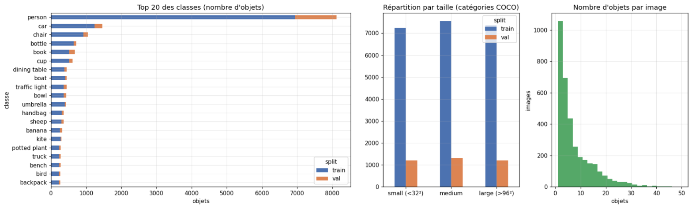 Exploration du dataset | 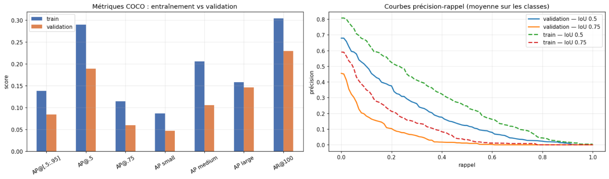 Métriques train/val et courbes précision-rappel |
| 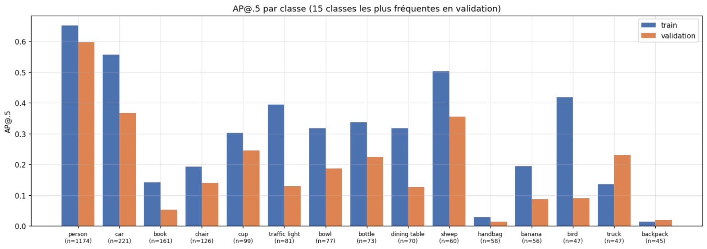 AP@.5 par classe | 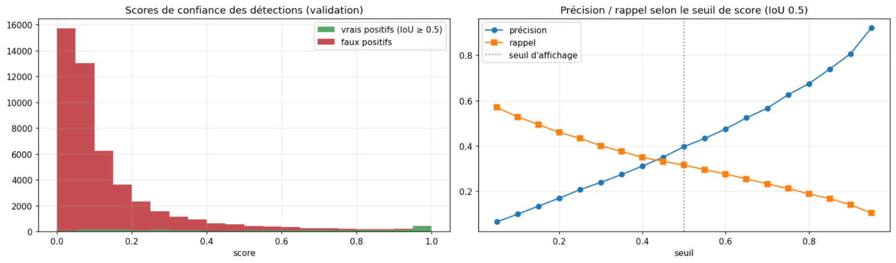 Scores de confiance et seuil |
| 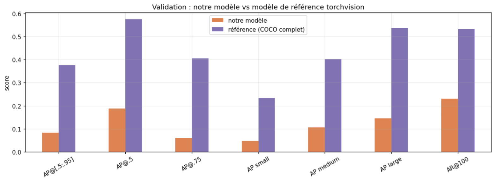 Comparaison avec la référence | 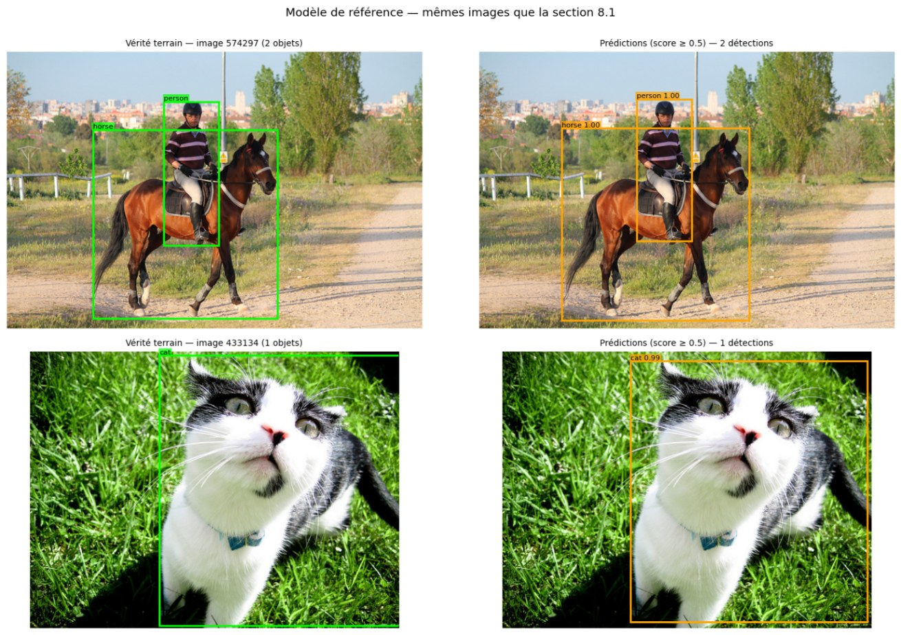 Détections du modèle de référence |
| 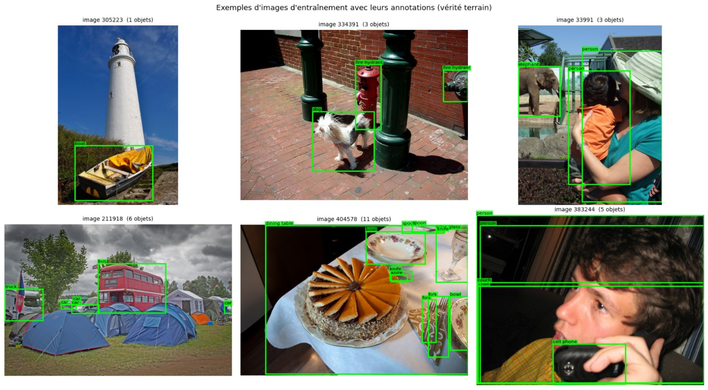 Annotations (vérité terrain) | 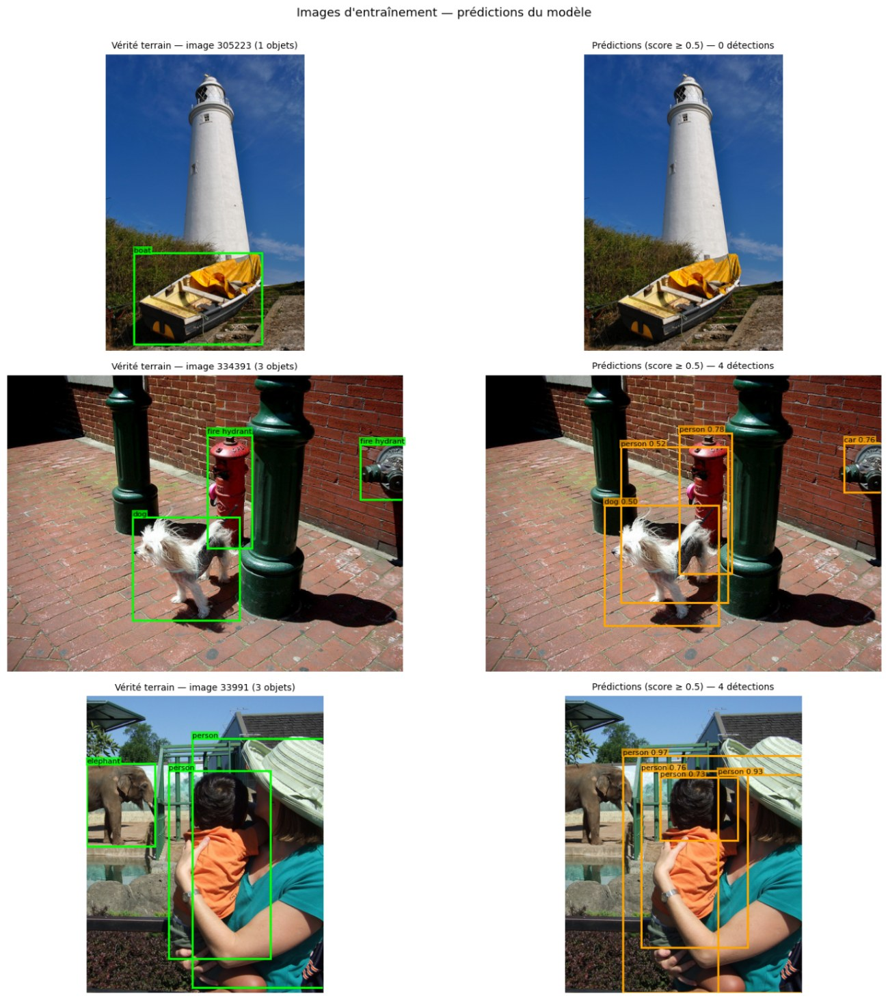 Prédictions sur des images d'entraînement |

> Le modèle entraîné (`faster_rcnn_r50_fpn.pth`, 167 Mo) n'est pas versionné : il dépasse la limite de 100 Mo de GitHub. Il est régénéré en relançant le notebook.

## Exécution sur Kaggle (recommandé)

1. Kaggle → **Create → New Notebook** → **File → Import Notebook** → importer le `.ipynb`.
2. **Add Input** → rechercher **« COCO 2017 »** → ajouter un dataset contenant `train2017`, `val2017` et `annotations` (le notebook localise automatiquement les dossiers).
3. **Settings → Accelerator → GPU** (T4 ou P100) et **Internet → On**.
4. **Save Version → Save & Run All**.

Configuration par défaut : 6 000 images de train2017, 500 images de val2017, 6 époques, images 512×853 (≈ 1 h 15 sur GPU T4). Ces valeurs se modifient dans le dictionnaire `CONFIG`. Les résultats ci-dessus ont été obtenus avec `num_train_images = 3000` et `epochs = 5` (≈ 30 min).

Les résultats (modèle `.pth`, historique, figures, `recap.json`) sont enregistrés dans `/kaggle/working/outputs`.

## Exécution locale (CPU, test rapide)

```bash
pip install -r requirements.txt
jupyter notebook TP_FasterRCNN_ResNet50_COCO_Kaggle.ipynb
```

Mettre `MODE = "coco128"` : le notebook télécharge automatiquement 128 images de COCO et des poids ResNet-50 ImageNet, et s'exécute sur CPU (performances limitées par le faible nombre d'images).

## Auteur

Ismail En-niou
